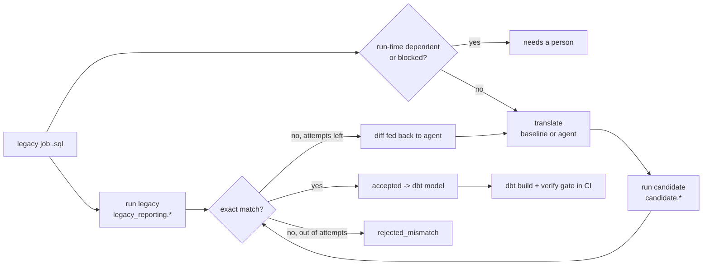

# sql-to-dbt-migration-agent

An LLM agent that migrates a customer's legacy SQL jobs to dbt, and **ships a model only when
a parallel run proves it returns exactly the same data**.

It is set up as a simulated customer engagement. Harbor & Pine Outfitters is a fictional
outdoor retailer with 24 nightly SQL jobs owned by six teams. Discovery, scope and handoff
notes are in [`engagement/`](engagement/). All data is synthetic, generated by
`customer/generate_data.py`. No company data is used.

The method comes from migrations I led in production: an LLM rewrite, a parallel run against
the legacy output, a comparison report and a retry, with one rule: if it doesn't match, it doesn't ship.

## Results

| | Rule-based baseline | Agent (Claude) |
|---|---:|---:|
| Jobs accepted (exact match) | **17 / 24** | *not run yet* |
| Simple / medium / hard accepted | 8/8 · 8/8 · 1/8 | *not run yet* |
| Rejected for mismatch | 0 | *not run yet* |
| Sent to a person, with the reason | 7 | *not run yet* |
| Mismatches shipped | **0** | **0** (enforced by the gate) |

The agent column is filled in by the first recorded run (`make record`). Until then it stays
empty rather than estimated. Per-job detail: [`report/scorecard_baseline.md`](report/scorecard_baseline.md).

### What the baseline shows
A rule engine handles the mechanical work: temp tables become CTEs, and hard-coded names
become `source()` and `ref()`. That covers every simple and medium job. It cannot handle the
five hard jobs that change their table after creating it (`UPDATE`, `DELETE`, `INSERT`).
Folding that logic into one `SELECT` is the part that needs judgement, and it is where the
agent has to earn its cost.

### What the gate does
Two jobs never reach a translator: `qa_sample_orders` uses `random()` and `open_orders_snapshot`
uses `current_date`. Their output changes with every run, so no comparison can prove a match.
The scorecard sends them to their owners with the decision needed (a seed, an as-of date).

## How it works



| Piece | File |
|---|---|
| Equivalence check: multiset compare in both directions, numbers rounded to 6 dp | `migrator/equivalence.py` |
| Rule-based translator (sqlglot) | `migrator/baseline.py` |
| Agent prompt, output schema, retry conversation | `migrator/agent.py` |
| Claude client with record / replay | `migrator/llm.py` |
| Orchestrator and scorecard | `migrator/run.py` |
| Shipping gate: every built dbt model equals its legacy table | `scripts/verify_dbt.py` |

**Design choices**
- **Exact match, not "looks right".** Rows are compared as a multiset, so a lost duplicate
  fails. A DECIMAL that became a DOUBLE with the same value is reported but does not fail.
- **Quirks are kept, not fixed.** The agent must reproduce legacy behaviour, such as the
  integer division in `repeat_purchase_rate`. It lists the quirks it notices, and they land in
  the model's `meta` for the owner.
- **Dependencies gate each other.** A job whose upstream job isn't migrated is blocked, not
  pointed at the legacy table.
- **Reproducible evals.** Every agent response is saved under `recordings/`, keyed by a hash of
  the model, effort, prompt and schema. CI replays them with no API key, and a changed prompt
  can't be served a stale answer.

## Run it

```bash
pip install -r requirements.txt
make demo        # data, tests, baseline, agent replay, dbt build, gate
```

`make record` runs the agent for real. It needs `ANTHROPIC_API_KEY`, uses `claude-opus-5-5` at
high effort by default (`MIGRATOR_MODEL` / `MIGRATOR_EFFORT` to change), and writes token
usage and cost to `report/usage_llm.json`.

## 2-minute walkthrough
1. `customer/legacy_jobs/customer_status.sql`: a job that sets status with three `UPDATE`s.
2. `report/scorecard_baseline.md`: the rule engine gives up on it, with the reason.
3. The agent's model for the same job, in `dbt_project/models/migrated/` (after `make record`).
4. `tests/test_migrator.py::test_retry_loop...`: a wrong first answer, the diff it is shown, and the fix.
5. CI: `scripts/verify_dbt.py` failing the build if any shipped model differs.

---
Artur Kochetkov · [arturkochetkov.dev](https://arturkochetkov.dev) · MIT licence
